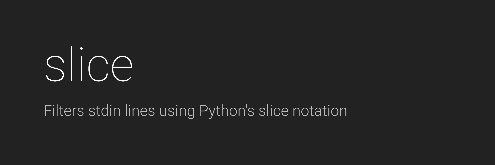

<p align="center"></p>

<p align="center"><strong>Filters stdin lines using Python's slice notation</strong></p>

<p align="center"><a href="LICENSE"></a> <a href="https://github.com/conao3/python-slice/stargazers"></a></p>

<p align="center"><a href="#installation">Install</a> | <a href="#usage">Usage</a> | <a href="#license">License</a></p>

<h1>slice</h1>

A command-line tool that filters stdin using Python's slice notation.

## Overview

`slice` reads lines from stdin and outputs a subset based on Python slice syntax. If you're familiar with Python's `list[start:stop:step]` notation, you already know how to use it.

## Installation

```bash
pipx install slice-bin
```

Using [pipx](https://pipx.pypa.io/) is recommended as it installs the tool in an isolated environment while making the `slice` command available globally. Alternatively, you can use `pip install slice-bin`.

## Usage

The basic syntax follows Python's slice notation: `[start:stop:step]`

### Get a single line

```bash
$ seq 10 | slice 3
4
```

### Get lines from index to end

```bash
$ seq 10 | slice 3:
4
5
6
7
8
9
10
```

### Get a range of lines

```bash
$ seq 10 | slice 3:5
4
5
```

### Get the last N lines

```bash
$ seq 10 | slice -3:
8
9
10
```

### Get the first N lines

```bash
$ seq 10 | slice :3
1
2
3
```

### Exclude the last N lines

```bash
$ seq 10 | slice :-3
1
2
3
4
5
6
7
```

### Get every Nth line

```bash
$ seq 10 | slice ::2
1
3
5
7
9
```

### Reverse order with step

```bash
$ seq 10 | slice ::-2
10
8
6
4
2
```

## License

Apache-2.0
